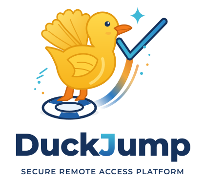

<p align="center">
  <picture>
    <source media="(prefers-color-scheme: dark)" srcset="assets/brand/duckjump-logo.svg">
    
  </picture>
</p>

# duckJump

**duckJump is a reimagining of [Apache Guacamole](https://guacamole.apache.org/):** a clientless, web-based
access bastion for SSH, RDP and VNC hosts, designed from the start as a PAM (*Privileged Access Management*)
tool: a credential vault, expiring access grants, session recording and a tamper-evident audit trail.

It is not a fork. Both the gateway and the session daemon were written from scratch:

| | Apache Guacamole | duckJump |
|---|---|---|
| Web gateway | Java (Tomcat) | Go, a single binary with the UI embedded |
| Session daemon | `guacd`, in C | `duckjumpd`, in Rust; RDP on [IronRDP](https://github.com/Devolutions/IronRDP), one process per session |
| Protocol | Guacamole (text) | DJTP, a native binary protocol; a `guacd` compatibility layer is planned |
| SSH terminal | rasterized on the server, sent as images | raw PTY stream, rendered in the browser by xterm.js |
| Credentials | stored in the connection settings | encrypted vault (AES-256-GCM), injected gateway → daemon only, never sent to the browser |
| Getting started | Tomcat + external database + guacd | embedded SQLite, rpm/deb packages with the services ready to run |

> Status: under active development (0.1). Some internal names (`duckjump-gw`, `duckjumpd`) come from the project's
> code name. What is planned: [ROADMAP.md](ROADMAP.md).

## Features

- **SSH, RDP and VNC** in the browser. RDP with NLA/TLS; VNC with its own RFB client, over TLS (VeNCrypt X.509)
  when the server offers it. Server keys (SSH host keys, RDP and VNC certificates) are pinned: a key nobody
  approved stops the session before any credential is sent, until an admin compares and approves it.
  When a connection has no stored credential, the user is asked when connecting (like mstsc), and nothing is stored.
- **Credential vault**: passwords and private keys are encrypted; users never see them.
- **Access grants** for users or groups, on a connection, a folder or a tag, with optional expiry
  (just-in-time access). Nobody bypasses grants, superadmins included. Grants are enforced on live sessions
  too: a session ends when its grant expires or is revoked or its user is disabled, and admins can terminate
  any session (UI, API or `duckjump-gw kill`).
- **Session recording**: SSH as asciicast (`.cast`), RDP/VNC in a native graphical format, with an in-browser
  player and configurable retention. Finished recordings can go to S3-compatible object storage (AWS S3, MinIO,
  Ceph), so duckjumpd and the gateway need no shared disk.
- **SQLite or PostgreSQL**: it starts on SQLite with nothing to set up; `duckjump-gw migrate-to-postgres` moves it
  to PostgreSQL (audit chain intact) when you need several gateways on one database.
- **Audit log** with a verifiable hash chain plus an HMAC chain keyed outside the database, so even someone
  with write access to the database cannot rewrite it unnoticed; optionally copied as it happens to syslog or
  a WORM file (`-audit-export`).
- **File transfer** (SSH, over SFTP) through a per-user **file tray** on the gateway: from your computer into a
  host, out of a host to your computer, or between two hosts. Separate `upload` / `download` permissions per
  grant; every file is kept with its SHA-256 for a while and every move is audited.
- **Edge sites**: an agent inside a closed network opens an outbound tunnel to the bastion and only reaches
  what its local allow list permits.
- **Local users** with password + TOTP, and **single sign-on with OpenID Connect** (Keycloak, Entra ID, Okta…):
  users are created on first login and matched by issuer and subject; their groups and, optionally, their role
  follow the provider's claims. Superadmin, admin, auditor and user roles.
- **REST API** described in OpenAPI 3.1, generated from the code.

## Architecture

```
browser ──HTTPS/WebSocket──▶ duckjump-gw (Go) ──DJTP/TCP(+TLS)──▶ duckjumpd (Rust) ─┬─ duckjumpd worker (SSH/VNC) ──▶ host
 React + xterm.js / canvas      │                                             └─ duckjumpd-rdp (IronRDP) ──RDP──▶ Windows host
                                ├─ local auth + TOTP, roles, CSRF protection
                                ├─ credential vault (AES-256-GCM)
                                ├─ grants, folders, tags, groups
                                ├─ chained audit log, recordings (SQLite)
                                └─ edge agent hub ◀── WSS + yamux ── duckjump-agent (closed network)
```

**DJTP** (frames `u32 len BE | u8 kind | payload`) carries JSON control messages, the terminal stream and, for
graphical sessions, display operations (size, PNG/JPEG image, copy, fill, cursor, end of frame). `duckjumpd` keeps
the remote framebuffer and sends only what changed; the browser acknowledges every frame, which is the flow
control (with a watchdog, so a lost acknowledgement never freezes a session). Format:
[`duckjumpd/crates/duckjump-proto/src/gfx.rs`](duckjumpd/crates/duckjump-proto/src/gfx.rs).

Running pieces on separate hosts: the gateway ↔ duckjumpd link carries live credentials, so give duckjumpd
`--tls-cert/--tls-key` and the gateway `DUCKJUMPD_TLS=1` with `DUCKJUMPD_TLS_FINGERPRINT` (`duckjumpd … --print-fingerprint`);
`duckjump-gw serve -relay-tls` does the same for the edge relay. Behind a reverse proxy, list it in
`-trusted-proxies` (client addresses for rate limits and audit, `X-Forwarded-Proto` for the Secure cookie).

| Path | What it is |
|---|---|
| `gateway/` | `duckjump-gw` (API, WebSocket, auth, vault, SQLite via sqlc, CLI) and `duckjump-agent` |
| `duckjumpd/crates/duckjumpd` | Session daemon: one worker process per session (SSH via russh, VNC), RDP worker proxy, recording |
| `duckjumpd/crates/duckjump-net` | Dialing targets and the edge relay, TLS with pinned certificates (shared with `duckjumpd-rdp`) |
| `duckjumpd/crates/duckjump-proto` | DJTP and the Guacamole protocol codec |
| `duckjumpd/crates/duckjump-gfx` | Framebuffer and PNG/JPEG tile encoding |
| `duckjumpd/rdp` | `duckjumpd-rdp`: RDP worker on IronRDP (separate workspace) |
| `web/` | React 19 + Vite UI (bun), English and Spanish |
| `packaging/` | rpm/deb packages and systemd services |

## Install

```sh
make packages      # dist/packages: duckjump and duckjump-agent, as rpm and deb (needs podman or docker)
sudo dnf install ./duckjump-0.1.0-1.x86_64.rpm     # or: sudo apt install ./duckjump_0.1.0-1_amd64.deb
```

The package creates the service user, generates the vault master key and the internal token (in
`/etc/duckjump`, root only), creates an `admin` superadmin with a random password (printed during the install
and saved to `/etc/duckjump/initial-admin-password`), and starts `duckjump.service` and
`duckjumpd.service` on **https://&lt;host&gt;:8443** with a self-signed certificate.

- Configuration: `/etc/duckjump/duckjump.env` (port, certificate, agent endpoint).
- CLI: `sudo duckjump user|secret|conn|grant|site …`
- Backups: `/var/lib/duckjump` **together with** `/etc/duckjump/master.key`; without the key the vault cannot
  be opened.
- Supported: RHEL/Rocky/Alma 9+, Debian 11+, Ubuntu 22.04+ (amd64).

**Edge agent** (`duckjump-agent`): in the UI, Sites → New site; put the token in `/etc/duckjump-agent/token`,
and the server address and allowed networks in `/etc/duckjump-agent/agent.env`.

## Development

Requirements: Go 1.26, Rust 1.91, bun, podman (test servers).

```sh
make run           # test sshd, VNC and xrdp + duckjumpd + duckjump-gw → http://127.0.0.1:8088 (admin / duckjump-admin-123)
make edge          # adds a simulated edge site: a closed network with an sshd and an agent
make dev-web       # UI with hot reload (proxies /api to the running stack)
make test          # Go, Rust, UI typecheck, and checks the OpenAPI spec is up to date
make generate      # sqlc, OpenAPI and the UI's API types
make stop
make help          # every target
```

### Database: SQLite, or PostgreSQL

`DUCKJUMP_DB` is a SQLite file by default. To move to PostgreSQL, stop the gateway and run

```bash
duckjump-gw migrate-to-postgres -to 'postgres://duckjump:secret@db:5432/duckjump'   # (sudo duckjump … on packages)
```

then set `DUCKJUMP_DB` to that URL. Everything is copied in one transaction into an empty database and the audit
chain is verified on arrival; the SQLite file is left untouched. On PostgreSQL several gateways can share the
database: live sessions are re-checked and can be terminated from any of them, and sessions of a gateway that
dies are closed by the others. Caveats for now: each edge agent talks to the gateway it connected to (run one
agent connection per gateway, or route a site's sessions to its gateway), and enable `-audit-export` on one
gateway only. `make postgres` / `PG=1 make run` run it locally; `make test-postgres` runs the suites on it.

### Recordings in S3

Set the same `DUCKJUMP_S3_ENDPOINT`, `DUCKJUMP_S3_BUCKET`, `DUCKJUMP_S3_REGION`, `DUCKJUMP_S3_ACCESS_KEY`,
`DUCKJUMP_S3_SECRET_KEY[_FILE]` (and `DUCKJUMP_S3_PATH_STYLE=1` for MinIO, `DUCKJUMP_S3_PREFIX`, default `recordings/`) for
duckjumpd and duckjump-gw. duckjumpd uploads each recording when the session ends and removes the local copy; a failed
upload stays on disk and is retried every minute. The gateway downloads, sizes and purges from the bucket. A
session still running is only on duckjumpd's disk, so watching it live needs the shared directory. `make minio` /
`S3=1 make run` locally; `make test-s3` tests both sides against MinIO.

### File transfer

Files never go host to host: they pass through the user's tray on the gateway (`-files <dir>`, or the S3 bucket
under `files/` when S3 is configured). In an SSH session the **Files** panel browses the host over SFTP (with the
connection's credentials): take a file into the tray, or send a tray file (or one from your computer) to the
host. Moving a file between two sessions is taking it out of one and sending it into the other. A grant needs
`can_upload` / `can_download` (`duckjump-gw grant … -upload -download`) besides connect. Taking a file pulled
from a host on to your computer needs `can_download` on that host still. Tray content is kept for `-file-ttl`
(7 days) and files are limited to `-file-max-size` (1 GiB); the records and hashes stay, and auditors see all
transfers (My files → All transfers) and can download the evidence while it is kept. RDP drive redirection and
VNC file transfer are not implemented. `make test-sftp` tests against OpenSSH.

### Single sign-on (OpenID Connect)

```bash
make keycloak                        # Keycloak + test realm on :18180 (users alice/bob/audrey, password <name>-password)
SSO=1 make run                       # the dev stack with "Sign in with Keycloak"
make test-oidc                       # SSO tests against that Keycloak (part of make test; SKIP_OIDC=1 skips)
```

In production: register a confidential client with redirect URI `https://<gateway>/api/v1/auth/oidc/callback`,
add `groups` (and roles) to the ID token, and set `DUCKJUMP_OIDC_ISSUER`, `DUCKJUMP_OIDC_CLIENT_ID`,
`DUCKJUMP_OIDC_CLIENT_SECRET[_FILE]`, `DUCKJUMP_OIDC_REDIRECT_URL` and, to take roles from the provider,
`DUCKJUMP_OIDC_ROLES_CLAIM` (e.g. `realm_access.roles`) with `DUCKJUMP_OIDC_ROLE_MAP`
(default `duckjump-superadmin=superadmin,duckjump-admin=admin,duckjump-auditor=auditor`). A username
already used by a local account cannot sign in through the provider. Disabling a user in the provider takes
effect at their next login; disable them in DuckJump too to end live sessions at once.

### API

REST under `/api/v1`. Sign in with `POST /api/v1/auth/login` (session cookie), then `POST /api/v1/auth/totp`
if the user has TOTP enabled. State-changing requests must carry the `X-DuckJump-Request` header (CSRF defense).

The contract, [`gateway/openapi/openapi.yaml`](gateway/openapi/openapi.yaml), is generated by `make generate`
from inline comments on the handlers:

```go
// openapi:operation
// summary: Create a folder
// tags: [folders]
// requestBody: { schema: FolderRequest }
// responses:
//   '201': { description: Created, schema: Folder }
//   '409': Error

func (s *Server) createFolder(w http.ResponseWriter, r *http.Request, p principal) error {
```

Method, path, roles, parameters and common errors come from the router. `go test ./...` fails if the spec is
out of date.

## License

duckJump is free software under the [GNU Affero General Public License v3.0 or later](LICENSE)
(AGPL-3.0-or-later). If you modify it and offer it as a network service, you must make the source code of your
version available to its users.

Apache Guacamole is a trademark of The Apache Software Foundation. duckJump is an independent project, not
affiliated with or endorsed by the ASF, and contains no Guacamole code.
